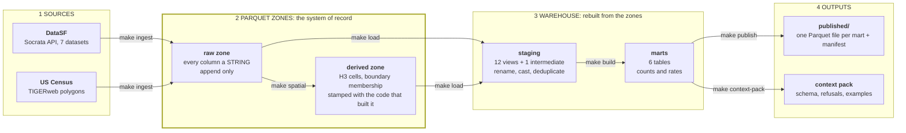

# sf-data-warehouse

An analytics warehouse built from seven public San Francisco datasets. Python
lands the raw records as Parquet, a second Python step assigns every point to
a neighborhood, district and H3 cell, and dbt models the result into tested
marts that run on DuckDB and BigQuery.

It rebuilds from a fresh clone with no cloud account, and every design
decision has a written record in [docs/decisions/](docs/decisions/).

> **Status:** not under active development. The scheduled jobs have been
> paused since 2026-10-23. Everything local still works. See [Status](#status).

| | |
|---|---|
| **Runs on a fresh clone** | `make setup && make ci-build`. No account, no credentials, no cost. |
| **Tested** | 150 dbt tests and 328 Python tests on every pull request. |
| **Reproducible** | CI drops the warehouse and rebuilds it from the Parquet files. |
| **Two engines** | One set of SQL for DuckDB and BigQuery. CI compiles both; the full BigQuery build runs by hand. |
| **Spatial** | About 610k points placed in 733 boundaries, in Python rather than SQL. |
| **Published** | One Parquet file per mart, plus a manifest. |
| **LLM-ready** | A generated context pack tells a model what the data holds and what to refuse. |
| **Documented** | 22 ADRs (13 active, 1 draft), 10 closed plans and a session log. |

## Quickstart

```bash
git clone https://github.com/mp321/sf-data-warehouse && cd sf-data-warehouse
make setup       # venv, dependencies, dbt packages, git hooks
make ci-build    # the whole pipeline from committed fixtures: no network, no account
make check       # most of the pull request gate
```

Needs Python 3.10 or newer, git and about 2 GB of disk. For live data, run
`make all`: it needs network access and still no credentials.
[SETUP.md](SETUP.md) covers Google Cloud, which only BigQuery and a bucket
zone need.

## What you can ask it

Three event datasets (311 cases, building permits, business registrations)
are aggregated by place and month.

| Question | Table |
|---|---|
| How many 311 cases of a given type were opened in the Mission last March, and how does that compare with other neighborhoods? | `mart_activity_by_neighborhood` |
| Where is permit activity concentrated, at about 460 m resolution? | `mart_activity_by_h3` |
| What are the population, housing, business and land area figures behind a rate? | `dim_neighborhood`, `dim_supervisor_district` |
| Where was a film or TV scene shot? | `mart_film_locations` |
| Is each source fresh, and how many rows lost their coordinates? | `mart_pipeline_freshness` |

Every count has a rate beside it, because the two rank places differently. By
311 volume the Mission is first of 41 neighborhoods. Per resident, Golden Gate
Park is first, on a population of 458.

Mart rules and how to pick a denominator:
[dbt/models/marts/README.md](dbt/models/marts/README.md).

## How it works

Boxes are what exists. Edge labels are the command that produces it.



- **The Parquet zones are the record.** DuckDB (the default) and BigQuery
  (optional) are both rebuilt from them and can be dropped at any time.
- **Geography is stored, not queried.** Each row's neighborhood, district and
  H3 cells are plain columns, so no model uses a geometry type or a spatial
  function. That is what lets the same SQL run on both engines.
- **A run uses one zone.** `data/raw` and `data/derived` by default, or a
  bucket when `RAW_ZONE_URI` and `DERIVED_ZONE_URI` are set ([ADR-9]).

| Command | Does | Network |
|---|---|---|
| `make ingest` | APIs to the raw zone. Delta datasets resume from a watermark; snapshot datasets refetch in full | yes |
| `make spatial` | Raw zone to derived zone. 23 s in full, 0.3 s when nothing moved | no |
| `make load` | Both zones into DuckDB. Safe to repeat | no |
| `make build` | Two checks, then dbt run and test | no |
| `make publish` | Marts to `published/`, one file each | no |
| `make all` | The first four, in order | yes |
| `make ci-build` | All five from committed fixtures, isolated in `data/ci/` | no |

`make build` stops before dbt if the derived zone is behind the data or the
code (`check-derived`) or if a snapshot partition is incomplete
(`check-snapshots`). None of these commands needs credentials on the local
zones. `make help` lists every target.

## Data sources

Every dataset carries a location, so each one joins to a neighborhood or a
cell.

| Dataset | Tier | Why it is here |
|---|---|---|
| 311 cases | core | High volume, daily updates, a real record lifecycle. The anchor. |
| Building permits | core | Messy money and unit fields; joins to 311 on place and time. |
| Registered business locations | core | Both a subject and a denominator. At 365k rows, also the H3 stress test. |
| Analysis neighborhoods | reference | The 41 polygons every spatial mart joins to. |
| Supervisor districts | reference | The 11 polygons, 2022 boundaries. |
| Census block groups | reference | 681 polygons with 2020 population, the denominator. |
| Film locations | demoted | Small and slow-moving: the pipeline canary and demo mart. |

311 cases and building permits start at 2024-01-01. The registry of datasets
is `vars.pipeline_sources` in [dbt/dbt_project.yml](dbt/dbt_project.yml).

## Design decisions

| Decision | Why | Record |
|---|---|---|
| Raw records land as all-STRING Parquet and are never edited | Typing, renaming and deduplication happen in dbt, where they are versioned and tested | [ADR-1], [ADR-18] |
| Geography is computed once, in Python | BigQuery has no H3 function and the two engines disagree near a boundary, so SQL geometry cannot run on both | [ADR-5], [ADR-6] |
| Every count mart carries rates | A count per area mostly tracks population | [ADR-10] |
| Paging orders by `(:updated_at, :id)` | Ordering by update time alone dropped rows when thousands shared a timestamp | [ADR-18] |
| Snapshot datasets refetch in full on every run | Each partition is then complete, which staging and the prune both rely on | [ADR-19] |
| The prune deletes a snapshot partition only when a later one provably covers it, and only by hand | Deleting by age, as a bucket lifecycle rule would, destroys 311 and permit history the API cannot serve again | [ADR-18], [ADR-21] |
| The derived zone records a hash of the code that built it | Stale geography otherwise passes every row-count check | [ADR-11] |
| The context pack lists refusals, not only schema | A model given a schema alone answers questions the data cannot support | [ADR-13] |

[docs/orientation.md](docs/orientation.md) summarises every ADR in one
sitting, and lists the five defects the first BigQuery build found after
months of clean compiles.

## Checks

| When | What runs | Credentials |
|---|---|---|
| Every pull request | Credential leak scan, ruff and sqlfluff, pytest, the full pipeline from fixtures, run manifests reconciled against the Parquet, dbt tests, a drop and rebuild of the warehouse, a BigQuery compile of every model, context pack drift | none |
| On a schedule (paused) | Daily ingest to the bucket, weekly BigQuery build, weekly raw zone retention report | yes |
| By hand | `make build-bigquery`, and `make parity-check` for row-for-row agreement across engines | yes |

The pull request gate needs no credentials, so it runs on forks. The cost is
that a green gate covers neither BigQuery nor a bucket zone. `make check` and
`ci.yml` differ in a few steps, listed in [CLAUDE.md](CLAUDE.md) under
"Commands".

## The context pack

[context-pack/](context-pack/) holds two generated documents, one for the
DuckDB warehouse and one for the published export. Each gives a language
model what it needs to query the data correctly and says what it must refuse.

The DuckDB pack carries 20 refusals, 6 mandatory disclosures, 4 traps, 13
declared joins and 6 examples that are executed when the pack is generated.
Refusals come in three kinds:

- **Absent:** spending, crime, rents, distances.
- **Mismeasured:** 311 counts reports, not incidents; permits are filings,
  not construction; the newest month is partial.
- **Misnormalised:** ranking by raw count; per-capita rates that divide by an
  April 2020 population.

Only `tools/context_pack/prose.yml` is written by hand. The rest is read from
the warehouse, and generation fails sooner than drop a refusal to fit the
token budget. The contract is
[docs/specs/context-pack.md](docs/specs/context-pack.md); the decisions are
[ADR-13] and [ADR-15].

## What it does not do

- **No city spending data.** Joining spending to 311 demand needs a crosswalk
  between budget department codes and 311's `agency_responsible`, two
  taxonomies with no reason to agree.
- **No ground truth.** 311 measures who reports, permits measure filings, and
  the business registry measures registrations.
- **No distances, buffers or routing,** and no rates per parcel or per street
  mile.
- **No current population.** Rates divide by the 2020 Decennial count. The ACS
  API needs a key, and credentials stay off the ingestion path ([ADR-1]).
- **No BigQuery build on pull requests.** CI proves the SQL compiles;
  `make parity-check` proves the rows match, by hand.
- **No scheduled publish.** `make publish` is manual ([ADR-12]).

The full list of cuts and gaps, with reasons, is section 4 of
[docs/orientation.md](docs/orientation.md).

## Repo layout

```
ingestion/          API ingestion, the raw and derived zones, the H3 step,
                    the checks, the prune and the loader
publish/            export.py: marts to Parquet with a manifest
dbt/                models (staging, intermediate, marts), macros, tests
tools/context_pack/ the context pack generator
context-pack/       the generated packs, committed so model changes show in PRs
tests/              pytest, plus fixtures so CI needs no network
scripts/            leak check, lint wrappers, the BigQuery parity check
docs/               decisions, specs, dev notes, archive
.github/workflows/  ci.yml on every PR; ingest, dbt and retention on a
                    schedule, all three paused
```

## Where to read more

| To find | Read |
|---|---|
| Why the repo is built this way, start to finish | [docs/orientation.md](docs/orientation.md) |
| A visual walkthrough that traces one 311 case through every layer | `docs/tour/index.html`, opened in a browser |
| The current architecture, every command, the hard constraints and a "where to change things" table | [CLAUDE.md](CLAUDE.md) |
| Setup, including Google Cloud | [SETUP.md](SETUP.md) |
| One decision, with the alternatives rejected and the costs accepted | [docs/decisions/](docs/decisions/), indexed in [docs/README.md](docs/README.md) |
| Mart rules and denominators | [dbt/models/marts/README.md](dbt/models/marts/README.md) |
| The model graph and column types without building anything | [docs/dbt/](docs/dbt/) |
| What broke and how it was diagnosed | [docs/dev-notes/](docs/dev-notes/) |
| Closed plans and superseded ADRs | [docs/archive/](docs/archive/) |

`CLAUDE.md` is the canonical architecture summary and the working agreement
for AI-assisted sessions, the same convention as `AGENTS.md`. Where this
README disagrees with it, `CLAUDE.md` is right.

## Status

Paused since 2026-10-23, with the bucket data current to that day. From
2026-10-04 the city began re-sending 120k+ 311 records a day, about four times
the usual volume. 311 history is never pruned, so the raw zone and the daily
job's network reads outgrew the free tier. Resuming the schedule needs a
decision on how to bound that growth. [ADR-22] is a draft of one, not yet
accepted. The measurements are in
[docs/dev-notes/2026-10-23.md](docs/dev-notes/2026-10-23.md).

Open, none scheduled:

- **Bound raw zone growth.** Accept, change or refuse [ADR-22], which
  proposes not storing 311 rows the city re-sent with only a new load stamp.
- **Read the withdrawal ledger.** Business closures by neighborhood and month.
- **Show the published export.** `dim_neighborhood` already carries GeoJSON
  and nothing renders it.
- **Tune H3 resolution per boundary set.** [ADR-6]'s measurements show block
  groups want a finer one.
- **Test the context pack on a model.** Put it in front of one and assert the
  refusals fire.

No plan is open; all ten are in [docs/archive/](docs/archive/).

## License

Code is MIT-licensed. All source data is public: DataSF (data.sf.gov) and the
US Census Bureau.

[ADR-1]: docs/decisions/adr-1-warehouse-targets.md
[ADR-5]: docs/decisions/adr-5-h3-computation.md
[ADR-6]: docs/decisions/adr-6-polygon-membership.md
[ADR-9]: docs/decisions/adr-9-cloud-raw-zone.md
[ADR-10]: docs/decisions/adr-10-narrowed-scope.md
[ADR-11]: docs/decisions/adr-11-derived-zone-code-stamp.md
[ADR-12]: docs/decisions/adr-12-published-export-layout.md
[ADR-13]: docs/decisions/adr-13-context-pack-format.md
[ADR-15]: docs/decisions/adr-15-bigquery-pack-declared-not-generated.md
[ADR-18]: docs/decisions/adr-18-the-raw-zone.md
[ADR-19]: docs/decisions/adr-19-withdrawn-registrations.md
[ADR-21]: docs/decisions/adr-21-withdrawn-keys-are-ledgered-then-prunable.md
[ADR-22]: docs/decisions/adr-22-311-load-stamp-resends.md
